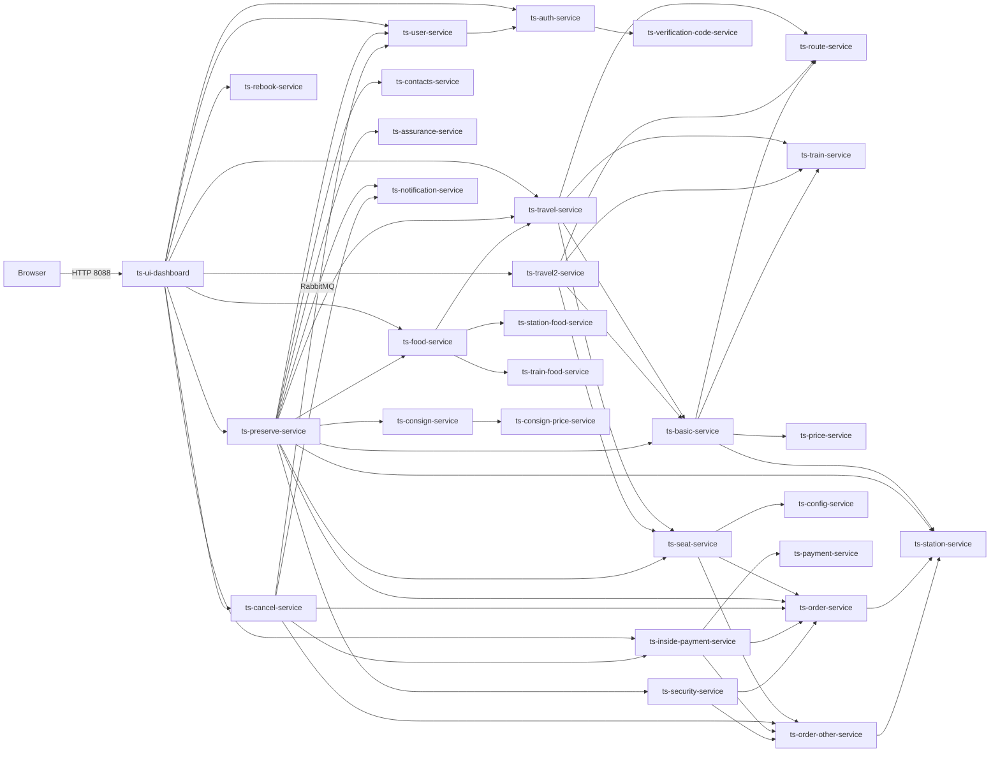

# Train-Ticket Microservice Dependency Graph

> Generated: 2026-10-14 | Source: static code analysis (`getServiceUrl` calls) + live curl probing + live Docker logs

---

## 1. Interaction Patterns (per Nesterov et al., 2023)

The paper defines 12 interface patterns across two groups:

**Asynchronous patterns (Table 3):**

| ID | Name | Description |
|---|---|---|
| IP-1 | Send (Receive) | X sends a single message to Y; Y receives it |
| IP-2 | Concurrent send (Receive) | X concurrently sends >1 messages to Y |
| IP-3 | Alternative send (Receive) | X sends exactly one of two+ alternative message sets to Y |
| IP-4 | Exchange | X sends to Y; Y sends a response back to X |
| IP-5 | Concurrent exchange | X concurrently sends >1 messages to Y; Y responds to each |
| IP-6 | Alternative exchange | X sends one of two+ alternatives to Y; Y responds accordingly |
| IP-7 | Multiple exchange | Iterative IP-4; exchange continues until X no longer needs responses |
| IP-8 | Racing incoming messages | X receives one among messages incoming from two or more agents |

**Mixed async+sync patterns (Table 4):**

| ID | Name | Description |
|---|---|---|
| IP-9 | Sync before exchange | X and Y synchronise before exchanging messages |
| IP-10 | Sync after exchange | X and Y synchronise after exchanging messages |
| IP-11 | Sync and exchange | Synchronisation and message exchange happen concurrently |
| IP-12 | Sync or exchange | X and Y either synchronise or exchange messages, not both |

---

## 1b. Mapping Train-Ticket Connections to Nesterov Interaction Patterns

### IP-1 — Send (Receive)
One service sends a single message to another with no response expected. Used for **fire-and-forget notifications**.

- `ts-preserve-service` ──[RabbitMQ]──► `ts-notification-service` (booking confirmation)
- `ts-cancel-service` ──[RabbitMQ]──► `ts-notification-service` (cancellation notice)

> RabbitMQ publish has no reply — publisher moves on immediately. Receiver consumes asynchronously.

---

### IP-4 — Exchange
X sends a message to Y; Y sends a response back. The standard **HTTP REST request-reply** pattern. This is the dominant pattern in the system — every `RestTemplate` call follows this shape.

**Core data lookups:**
- `ts-basic-service` ↔ `ts-train-service` (request train type → receive type info)
- `ts-basic-service` ↔ `ts-route-service` (request route → receive station list)
- `ts-basic-service` ↔ `ts-price-service` (request price config → receive rates)
- `ts-basic-service` ↔ `ts-station-service` (request station name → receive name)
- `ts-order-service` ↔ `ts-station-service`
- `ts-order-other-service` ↔ `ts-station-service`
- `ts-consign-service` ↔ `ts-consign-price-service`
- `ts-user-service` ↔ `ts-auth-service`

**Booking flow (ts-preserve-service):**
- ↔ `ts-security-service` (send passenger info → receive pass/fail)
- ↔ `ts-contacts-service` (send contact ID → receive contact info)
- ↔ `ts-travel-service` (send trip query → receive availability)
- ↔ `ts-seat-service` (send reserve request → receive seat assignment)
- ↔ `ts-order-service` (send order → receive order ID)
- ↔ `ts-assurance-service`, `ts-food-service`, `ts-consign-service` (optional, same shape)

**Cancellation flow (ts-cancel-service):**
- ↔ `ts-order-service`, `ts-order-other-service` (get + update order)
- ↔ `ts-inside-payment-service` (request refund → receive confirmation)
- ↔ `ts-user-service` (get email → receive email address)

**Payment flow (ts-inside-payment-service):**
- ↔ `ts-order-service` / `ts-order-other-service` (update status → receive ack)
- ↔ `ts-payment-service` (record payment → receive ack)

**Seat service:**
- ↔ `ts-order-service`, `ts-order-other-service` (query booked seats → receive list)
- ↔ `ts-config-service` (get allocation config → receive value)

**Security service:**
- ↔ `ts-order-service`, `ts-order-other-service` (check history → receive result)

**Travel/Travel2 service:**
- ↔ `ts-basic-service`, `ts-route-service`, `ts-seat-service`, `ts-train-service`

**Food service:**
- ↔ `ts-travel-service`, `ts-station-food-service`, `ts-train-food-service`

**Rebook service:**
- ↔ `ts-order-service`, `ts-order-other-service`, `ts-travel-service`, `ts-travel2-service`, `ts-route-service`, `ts-seat-service`, `ts-train-service`, `ts-inside-payment-service`

**Admin services:**
- `ts-admin-basic-info-service` ↔ `ts-train-service`, `ts-station-service`, `ts-price-service`, `ts-config-service`, `ts-contacts-service`
- `ts-admin-order-service` ↔ `ts-order-service`, `ts-order-other-service`
- `ts-admin-travel-service` ↔ `ts-travel-service`, `ts-travel2-service`, `ts-route-service`, `ts-train-service`, `ts-station-service`
- `ts-admin-route-service` ↔ `ts-route-service`, `ts-station-service`
- `ts-admin-user-service` ↔ `ts-user-service`

---

### IP-5 — Concurrent Exchange
X concurrently sends >1 messages to Y; Y responds to each. Used in **parallel trip search**.

- `ts-travel-service` ↔ `ts-basic-service` — for each trip in DB, a separate thread sends a detail request and waits for the response (via `ExecutorService` / `MyCallable`). Multiple exchanges fire concurrently, all to the same target service.
- `ts-travel2-service` ↔ `ts-basic-service` — same pattern for regional trains.

```
ts-travel-service
  ├──[thread]──► ts-basic-service (trip G1234) ◄──[response]──┐
  ├──[thread]──► ts-basic-service (trip G1235) ◄──[response]──┤ gather
  └──[thread]──► ts-basic-service (trip G1236) ◄──[response]──┘
```

---

### IP-8 — Racing Incoming Messages
X receives one among messages incoming from two or more agents. Used where a service must handle inputs arriving from multiple upstream callers independently.

- `ts-notification-service` receives messages from both `ts-preserve-service` and `ts-cancel-service` via RabbitMQ — whichever publishes first is processed; the service does not know in advance which will arrive.
- `ts-order-service` receives requests from multiple callers (`ts-preserve-service`, `ts-cancel-service`, `ts-seat-service`, `ts-security-service`, `ts-inside-payment-service`, `ts-rebook-service`) — each inbound call races to be handled.
- `ts-station-service` receives station-lookup requests from `ts-basic-service`, `ts-order-service`, `ts-order-other-service`, `ts-admin-travel-service`, `ts-admin-route-service` — multiple senders, one receiver.

---

### IP-9 — Sync Before Exchange
X and Y execute a synchronous action before exchanging messages. Used in the **login + booking flow** where authentication must complete (synchronous JWT validation handshake) before any downstream message exchange begins.

- `ts-user-service` ↔ `ts-auth-service`: user login requires auth service to synchronously verify credentials first; only after that is the JWT issued and downstream calls (exchange) proceed.
- Every service: Spring Security filter synchronously validates the JWT token on every inbound request before the handler method (and any downstream REST call) executes.

---

## 1c. Pattern Summary Table

| Pattern | Instances in Train-Ticket | Protocol |
|---|---|---|
| **IP-1** Send (Receive) | preserve→notification, cancel→notification | RabbitMQ (async, no reply) |
| **IP-4** Exchange | All ~50 point-to-point REST calls (see §1b) | HTTP RestTemplate |
| **IP-5** Concurrent Exchange | travel↔basic (per trip, parallel threads), travel2↔basic | HTTP RestTemplate + ExecutorService |
| **IP-8** Racing Incoming Messages | notification-service (2 publishers), order-service (6+ callers), station-service (5+ callers) | RabbitMQ / HTTP |
| **IP-9** Sync Before Exchange | auth validation before every downstream call; login flow | HTTP (sync JWT check then REST) |

---

## 1d. REST vs RabbitMQ Usage

| Protocol | Used Where | Pattern |
|---|---|---|
| **HTTP REST** (RestTemplate) | Every service-to-service data call (~50 connections) | IP-4, IP-5, IP-9 |
| **RabbitMQ** | preserve→notification (booking email), cancel→notification (cancel email) | IP-1, IP-8 |

RabbitMQ is used in **exactly 2 publish paths**, both terminating at `ts-notification-service`. Everything else is HTTP REST.

---

## 2. Full Service → Dependency Map

```
ts-ui-dashboard (nginx)
  └─[HTTP proxy]─► all /api/v1/* routes below

ts-auth-service
  └─► ts-verification-code-service   (validate captcha on login)
  ◄── ts-user-service                (user service calls auth to create/delete auth accounts)

ts-user-service
  └─► ts-auth-service                (create/delete auth account when user is registered)

ts-preserve-service            [BOOKING FLOW - G/D trains]
  ├─► ts-security-service      1. check passenger security
  ├─► ts-contacts-service      2. get passenger contact info
  ├─► ts-travel-service        3. check trip / seat availability
  ├─► ts-basic-service         4. get travel detail (price, distance)
  ├─► ts-seat-service          5. assign seat
  ├─► ts-order-service         6. create order
  ├─► ts-assurance-service     7. (optional) buy insurance
  ├─► ts-food-service          8. (optional) order food
  ├─► ts-consign-service       9. (optional) add consignment
  ├─► ts-station-service       resolve station names
  ├─► ts-user-service          get user info
  └─►(RabbitMQ publish)──► ts-notification-service   send booking email/SMS

ts-preserve-other-service      [BOOKING FLOW - other/regional trains]
  ├─► ts-security-service
  ├─► ts-contacts-service
  ├─► ts-travel2-service       (uses travel2 instead of travel)
  ├─► ts-basic-service
  ├─► ts-seat-service
  ├─► ts-order-other-service   (uses order-other instead of order)
  ├─► ts-assurance-service
  ├─► ts-food-service
  ├─► ts-consign-service
  ├─► ts-station-service
  └─► ts-user-service

ts-basic-service               [CORE PRICE/ROUTE CALCULATOR]
  ├─► ts-train-service         get train type info
  ├─► ts-route-service         get route (station list + distances)
  ├─► ts-price-service         get price rates
  └─► ts-station-service       resolve station IDs to names

ts-travel-service              [TRIP SEARCH - high-speed G/D]
  ├─► ts-basic-service         calculate trip detail
  ├─► ts-route-service         get route info
  ├─► ts-seat-service          get remaining seat counts
  └─► ts-train-service         get train type

ts-travel2-service             [TRIP SEARCH - regular/regional trains]
  ├─► ts-basic-service
  ├─► ts-route-service
  ├─► ts-seat-service
  └─► ts-train-service

ts-seat-service                [SEAT MANAGEMENT]
  ├─► ts-order-service         query booked seats on G/D trains
  ├─► ts-order-other-service   query booked seats on other trains
  └─► ts-config-service        get allocation config (e.g. DirectTicketAllocationProportion)

ts-order-service               [ORDER CRUD - G/D trains]
  └─► ts-station-service       resolve station IDs

ts-order-other-service         [ORDER CRUD - regional trains]
  └─► ts-station-service

ts-security-service            [SECURITY CHECK]
  ├─► ts-order-service         check order history for security violations
  └─► ts-order-other-service

ts-cancel-service              [TICKET CANCELLATION]
  ├─► ts-order-service         get + update order
  ├─► ts-order-other-service
  ├─► ts-inside-payment-service  refund payment
  ├─► ts-user-service          get user email
  └─► ts-notification-service  send cancellation email

ts-rebook-service              [REBOOKING]
  ├─► ts-order-service
  ├─► ts-order-other-service
  ├─► ts-travel-service        find new trip
  ├─► ts-travel2-service
  ├─► ts-route-service
  ├─► ts-seat-service
  ├─► ts-train-service
  └─► ts-inside-payment-service  handle price difference payment

ts-inside-payment-service      [INTERNAL PAYMENT]
  ├─► ts-order-service         update order status to PAID
  ├─► ts-order-other-service
  └─► ts-payment-service       record payment transaction

ts-food-service                [FOOD AGGREGATOR]
  ├─► ts-travel-service        verify trip exists
  ├─► ts-station-food-service  list food at departure station
  └─► ts-train-food-service    list food on train

ts-consign-service             [LUGGAGE CONSIGNMENT]
  └─► ts-consign-price-service  calculate consignment price

ts-route-plan-service          [ROUTE PLANNING / MULTI-LEG]
  ├─► ts-route-service
  ├─► ts-travel-service
  └─► ts-travel2-service

ts-travel-plan-service         [TRIP PLAN WITH SEAT SUGGESTION]
  ├─► ts-route-plan-service
  ├─► ts-travel-service
  ├─► ts-travel2-service
  ├─► ts-seat-service
  └─► ts-train-service

ts-admin-basic-info-service    [ADMIN: manage stations/trains/prices]
  ├─► ts-train-service
  ├─► ts-station-service
  ├─► ts-price-service
  ├─► ts-config-service
  └─► ts-contacts-service

ts-admin-order-service         [ADMIN: manage orders]
  ├─► ts-order-service
  └─► ts-order-other-service

ts-admin-travel-service        [ADMIN: manage trips]
  ├─► ts-travel-service
  ├─► ts-travel2-service
  ├─► ts-route-service
  ├─► ts-train-service
  └─► ts-station-service

ts-admin-route-service         [ADMIN: manage routes]
  ├─► ts-route-service
  └─► ts-station-service

ts-admin-user-service          [ADMIN: manage users]
  └─► ts-user-service
```

---

## 3. Leaf Services (no outgoing HTTP calls)

These services are pure data stores — they only serve REST CRUD, backed by their own MongoDB instance:

| Service | Purpose | DB |
|---|---|---|
| ts-train-service | Train type definitions | ts-train-mongo |
| ts-route-service | Routes (ordered station lists) | ts-route-mongo |
| ts-station-service | Station ID ↔ Name lookup | ts-station-mongo |
| ts-price-service | Price rates per (trainType, route) | ts-price-mongo |
| ts-config-service | System config key/values | ts-config-mongo |
| ts-contacts-service | Passenger contact records | ts-contacts-mongo |
| ts-assurance-service | Insurance records | own mongo |
| ts-payment-service | Payment records | own mongo |
| ts-consign-price-service | Consign price rules | own mongo |
| ts-station-food-service | Food vendors at stations | own mongo |
| ts-train-food-service | Food on trains | own mongo |
| ts-notification-service | Email/SMS (async via MQ) | — |
| ts-verification-code-service | Captcha image generation | Redis |

---

## 4. Key Request Flows (end-to-end)

### 4a. Login
```
Browser → nginx (8088)
  → POST /api/v1/users/login  → ts-user-service (12342)
      → ts-auth-service (12340)  [verify credentials, JWT sign]
  ← JWT token returned to browser
```
Captcha (optional before login):
```
Browser → GET /api/v1/verifycode/generate → ts-verification-code-service (15678)
```

### 4b. Search Trains
```
Browser → POST /api/v1/travelservice/trips/left  → ts-travel-service (12346)
    → ts-basic-service (15680)
        → ts-train-service (14567)
        → ts-route-service (11178)
        → ts-price-service (16579)
        → ts-station-service (12345)
    → ts-seat-service  [count remaining seats]
        → ts-order-service (12031)
        → ts-config-service (15679)
  ← list of available trips with prices returned
```
For regular trains: same flow via `ts-travel2-service` (16346) + `ts-order-other-service`.

### 4c. Book a Ticket (ts-preserve-service)
```
Browser → POST /api/v1/preserveservice/preserve
  → ts-security-service    [1. security check]
      → ts-order-service
  → ts-contacts-service    [2. get passenger info]
  → ts-travel-service      [3. check trip + seats]
  → ts-basic-service       [4. calc price]
  → ts-seat-service        [5. reserve seat]
  → ts-order-service       [6. create order]  ← writes to ts-order-mongo
  → ts-assurance-service   [7. optional insurance]
  → ts-food-service        [8. optional food]
      → ts-travel-service
      → ts-station-food-service
      → ts-train-food-service
  → ts-consign-service     [9. optional luggage]
      → ts-consign-price-service
  →(RabbitMQ)→ ts-notification-service  [10. send confirmation email]
  ← order confirmation returned
```

### 4d. Pay for Ticket
```
Browser → POST /api/v1/inside_pay_service/inside_payment
  → ts-inside-payment-service
      → ts-order-service       [update status → PAID]
      → ts-payment-service     [record transaction]
```

### 4e. Cancel Ticket
```
Browser → POST /api/v1/cancelservice/cancel
  → ts-cancel-service
      → ts-order-service        [get order + set CANCELLED]
      → ts-inside-payment-service  [refund]
      → ts-user-service         [get user email]
      → ts-notification-service [send cancellation email]
```

---

## 5. Docker Port Map

| Service | Internal Port | Host Port |
|---|---|---|
| ts-ui-dashboard (nginx) | 8080 | **8088** |
| ts-auth-service | 12340 | 12340 |
| ts-user-service | 12342 | 12342 |
| ts-station-service | 12345 | 12345 |
| ts-travel-service | 12346 | 12346 |
| ts-contacts-service | 12347 | 12347 |
| ts-order-service | 12031 | 12031 |
| ts-travel2-service | 16346 | 16346 |
| ts-train-service | 14567 | 14567 |
| ts-route-service | 11178 | 11178 |
| ts-price-service | 16579 | 16579 |
| ts-config-service | 15679 | 15679 |
| ts-basic-service | 15680 | 15680 |
| ts-ticketinfo-service | 15681 | 15681 |
| ts-verification-code-service | 15678 | 15678 |

---

## 6. Login Profiles

### Admin Account
| Field | Value |
|---|---|
| **Username** | `admin` |
| **Password** | `222222` |
| **Role** | ROLE_ADMIN |
| **User ID** | `921b7c08-c882-4d61-9252-a0788356f020` |
| **Login URL** | http://localhost:8088 |

### Regular Users
| Username | Password | Email | User ID |
|---|---|---|---|
| `fdse_microservice` | `111111` | trainticket_notify@163.com | 4d2a46c7-71cb-4cf1-b5bb-b68406d9da6f |
| `newuser` | `111111` | newuser@example.com | 0a9a44a4-d370-446c-a6bc-7454b79aa884 |
| `rahul_sharma` | `111111` | rahul.sharma@example.in | e9f3fc31-babb-4fde-8baa-b070bc9bc7e1 |
| `priya_patel` | `111111` | priya.patel@example.in | 97a33529-8ab5-43bb-a656-9b7dceadc89e |

> Default password for non-admin users is `111111` (set at creation time). If changed, use the password set then.

---

## 7. Available Trips (Live Data)

### High-Speed Trains (G/D) — ts-travel-service
| Train | Route | From → To | Train Type |
|---|---|---|---|
| G1234 | 92708982 | Shanghai → Taiyuan | GaoTieOne |
| G1235 | aefcef3f | Shanghai → Taiyuan | GaoTieOne |
| G1236 | a3f256c1 | Shanghai → Taiyuan | GaoTieOne |
| G1237 | 084837bb | Shanghai → Taiyuan | GaoTieTwo |
| D1345 | f3d4d4ef | Shanghai → Taiyuan | DongCheOne |
| G2001 | b04df36c | (Indian route) | — |

### Stations Available
**Chinese:** Shang Hai, Shang Hai Hong Qiao, Tai Yuan, Bei Jing, Nan Jing, Shi Jia Zhuang, Xu Zhou, Ji Nan, Hang Zhou, Jia Xing Nan, Zhen Jiang, Wu Xi, Su Zhou

**Indian:** Bangalore, Delhi, Mumbai, Chennai, Kolkata, Hyderabad, Ahmedabad, Pune, Jaipur, Bhopal, Shenzhen

---

## 8. Mermaid Graph (visual)




---

## 9. Live Log Observations (from Docker container logs)

These were captured from actual running containers during curl probing on 2026-10-14.

### ts-auth-service — Login flow confirmed
```
INFO  auth.controller.UserController        : Login request of username: admin
INFO  auth.security.UserDetailsServiceImpl  : UsernamePasswordAuthenticationToken username: admin
INFO  auth.service.impl.TokenServiceImpl    : USER TOKEN: eyJhbGci...
INFO  auth.service.impl.TokenServiceImpl    : USER ID: 921b7c08-c882-4d61-9252-a0788356f020
```
**Pattern**: ts-user-service delegates to ts-auth-service which does the credential check + JWT sign.

### ts-travel-service — Route fan-out confirmed
```
INFO  TravelServiceImpl : Query for Station id → Response(status=1, data=shanghai)
INFO  TravelServiceImpl : Query for Station id → Response(status=1, data=taiyuan)
INFO  TravelServiceImpl : [Get Route By Id] Route ID: b04df36c... (Delhi→Bangalore)
INFO  TravelServiceImpl : [Get Route By Id] Route ID: 0b23bd3e... (Shanghai→Taiyuan)
```
**Pattern**: For each trip in DB, travel-service fetches its route from ts-route-service (one call per trip = fan-out).

### ts-basic-service — Price calculation chain
```
INFO  BasicServiceImpl : [Check Station Exists] stationName: Shang Hai
INFO  BasicServiceImpl : [Check Station Exists] stationName: Tai Yuan
INFO  BasicServiceImpl : [Query Train Type] Train Type: GaoTieOne
INFO  BasicServiceImpl : [Get Route By Id] Route ID: 0b23bd3e... → Success
INFO  BasicServiceImpl : [Query For Price Config] RouteId: 0b23bd3e, TrainType: GaoTieOne
```
**Pattern**: Every trip detail request hits 4 downstream services: station → train → route → price.

### ts-station-service — Hot path (called most frequently)
```
INFO  StationController : Query for station id, StationName: Shang Hai  (×4 in one search)
INFO  StationController : Query for station id, StationName: Tai Yuan   (×4 in one search)
```
**Pattern**: Station lookup is called for EVERY trip being evaluated — highest call frequency of all leaf services.

### ts-contacts-service — Startup + runtime
```
WARN  ContactsServiceImpl : AddContacts Fail. Contacts already exists (seed data dedup on boot)
INFO  ContactsController  : [Get All Contacts]
INFO  ContactsController  : [VerifyLogin] Success
INFO  ContactsServiceImpl : [AddContacts] Success
```

### ts-config-service
```
WARN  ConfigServiceImpl : Config DirectTicketAllocationProportion already exists (seed on boot)
INFO  ConfigController  : Query all config → success
```

---

## 10. Known Runtime Issues (from logs)

| Issue | Service | Log Evidence | Impact |
|---|---|---|---|
| `/trains/byName/{n}` returns 404 | ts-train-service | `Retrieve train,TrainTypeId: byName` (Spring Boot 1.x path conflict with `/trains/{id}`) | Trip search price calc fails |
| `POST /trains/byNames` returns 405 | ts-train-service | `HttpRequestMethodNotSupportedException: POST not supported` | Batch train type lookup fails |
| Trip `trainTypeId` field empty | ts-travel-service | Basic-service receives `trainTypeId:""` in Travel object | Train type lookup skipped |
| Seed data duplication on restart | ts-contacts, ts-config | `already exists` WARN on boot | Harmless (dedup guard works) |

---

## 11. Filtered Logs File

See `service-filtered.logs` in this repo for clean, bootstrap-free logs from all running services.
